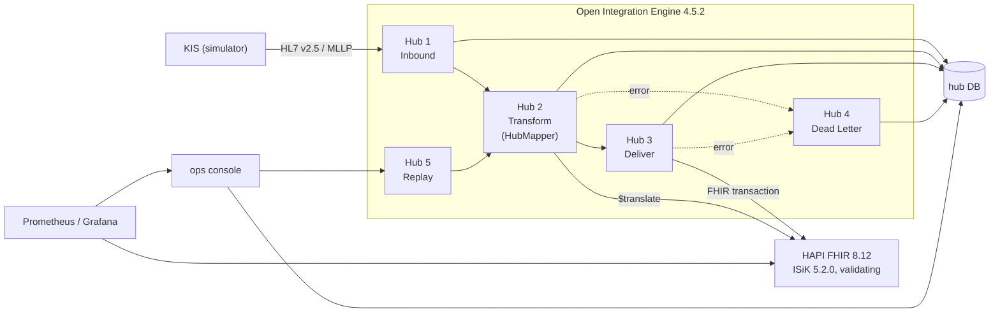

# Hospital Integration Hub

**HL7 v2 → ISiK Stufe 5 FHIR R4 on Open Integration Engine (Mirth fork).**
A German hospital information system (KIS) sends ADT, lab, order and document messages over MLLP. The hub stores them, maps them to ISiK-conformant FHIR resources, validates them on a HAPI FHIR server, and handles everything that goes wrong in production: retries with back-off, out-of-order arrival, patient merges, a dead-letter queue with replay, and monitoring.

[](https://github.com/adityashukla55/Hospital-Integration-Hub/actions/workflows/ci.yml)

> ISiK Stufe 5 became binding for KIS vendors in June 2026, with a deadline of 31 May 2027. This repo shows the integration work behind it: package `de.gematik.isik` **5.2.0**.



## Run it

Requirements: Docker with about 4 GB RAM for the containers. Node 24 is only needed for tests and the simulator.

```bash
make up      # or: docker compose up -d --build
```

The first start downloads and installs the ISiK packages into HAPI, which takes a few minutes. `engine-init` then deploys the channels.

```bash
make demo    # admission, lab order + results, transfer, discharge letter (+ replacement), discharge, a bad lab code, an unsupported event
```

| | |
| --- | --- |
| Ops console (messages, dead letters, replay) | http://localhost:8088 |
| FHIR server | http://localhost:8080/fhir |
| Grafana dashboard | http://localhost:3000 |
| OIE Administrator / REST API | https://localhost:8443 (admin / admin) |
| MLLP inbound | localhost:6661 |

`make replay-corpus` sends the 209 generated messages, `make load` runs the load test, and `make down` / `make clean` stop the stack.

## What is mapped

| HL7 v2 | ISiK Stufe 5 / FHIR R4 |
| --- | --- |
| ADT^A01, A04 admit / register | ISiKPatient, ISiKKontaktGesundheitseinrichtung, ISiKVersicherungsverhaeltnisGesetzlich, ISiKAbrechnungsfall, ISiKDiagnose |
| ADT^A02 transfer, A03 discharge, A08 update | Encounter location history, status, period, §301 Entlassungsgrund |
| ADT^A40 merge | retired Patient `replaced-by` survivor, every reference rewritten, one transaction |
| ORU^R01 lab result | ISiKLaboruntersuchung (LOINC, UCUM, reference ranges, flags) + DiagnosticReport |
| ORM^O01, OML^O21 order | ServiceRequest (placer/filler numbers, status from ORC-1) |
| MDM^T02, T10 document | ISiKDokumentenMetadaten (KDL + IHE XDS codes) + ISiKBinary (PDF) |
| DG1 (+ ZDG) | ISiKDiagnose with ICD-10-GM, Diagnosesicherheit, Seitenlokalisation |

Field-level rules are in **[docs/mapping-spec.md](docs/mapping-spec.md)** (v2 field → FHIR path → ISiK must-support).

## Design choices

- **Mapping as a tested library, not transformer spaghetti.** All logic is TypeScript in [`mapper/`](mapper), compiled to ES5 with only the ES5 standard library, so the compiler rejects anything Rhino cannot run. It is deployed as one OIE code template, and each channel script is about 30 lines of glue. CI runs the bundle in the engine's own Rhino 1.7.13 and compares it to Node output for all 223 golden messages ([ADR 0001](docs/adr/0001-mapping-library-compiled-to-es5.md)).
- **Integration as code.** Channels are defined in [`engine/src/channels.ts`](engine/src/channels.ts) and rendered to OIE 4.5 channel XML ([`engine/channels/`](engine/channels)). `engine/tools/deploy.ts` pushes the config map, code templates and channels through the OIE REST API and deploys them downstream-first.
- **Idempotent by construction.** Conditional updates on business identifiers (Patientennummer, Aufnahmenummer, filler order number, document number). Provenance and Binary ids are derived from the message key. Replaying a message twice changes nothing.
- **Out-of-order safe.** Patient and Encounter are read, reconciled and written with `If-Match`. An A08 that overtakes its A01 is fine, an A01 arriving after the A03 cannot reopen the stay, and an old message cannot overwrite newer demographics. Lab results that arrive before the admission wait with exponential back-off ([ADR 0004](docs/adr/0004-read-reconcile-write.md)).
- **Fail loudly, fix with data, replay.** An unmapped lab code or unit is a dead letter with its exact v2 location (`OBX[1]-3`), not a silently wrong resource. Add the code to a ConceptMap in [`terminology/`](terminology), re-seed, and press *Replay all* ([ADR 0005](docs/adr/0005-store-and-forward-dead-letter-replay.md), [ADR 0006](docs/adr/0006-terminology-as-conceptmaps.md)).
- **Validated on write.** HAPI FHIR validates every transaction against ISiK 5.2.0, and invalid data is rejected into the dead-letter queue ([ADR 0003](docs/adr/0003-hapi-fhir-validation-on-write.md)).

More in [docs/architecture.md](docs/architecture.md).

## Tests and proof

```bash
npm ci && npm test
```

| Check | What it covers |
| --- | --- |
| `mapper/test/*.test.ts` | parser and escaping, DST-aware timestamps, every mapper, error locations |
| `mapper/test/delivery.test.ts` | delivery against an in-memory FHIR server: replay idempotency, A08 before A01, A01 after A03, ORU before ADT, A40 merge with reference rewrite, T10 supersede, retry vs dead-letter classification |
| `testdata/golden` (14 hand-written) and `testdata/corpus` (209 generated) | expected FHIR output for every message, byte-compared |
| `engine/test/rhino-smoke.js` | the bundle in OIE's Rhino 1.7.13 produces identical output |
| `tools/validate.sh` | HL7 FHIR Validator against `de.gematik.isik#5.2.0` (CI job `validate`) |
| `make load` | sustained MLLP load, ACK latency percentiles |

The corpus comes from a seeded generator ([`simulator/`](simulator)): German names with Vorsatzwort, KVNR with valid check digit, insurers, wards, ICD-10-GM diagnoses, lab panels, discharge letters and duplicate registrations that get merged. All data is synthetic.

### Measured

Whole stack on one laptop (Docker VM with 4 vCPU and 4 GB, all containers running), 17 Nov 2026. Details and method: [docs/results.md](docs/results.md).

| What | Result |
| --- | --- |
| End-to-end, 209-message corpus, ISiK validation on write | 209/209 delivered, 0 dead letters |
| Same corpus sent again | 0 new FHIR resources (idempotent on the real server) |
| Replay through the API, bad lab code, non-HL7 payload, ADT^A31 | delivered again without duplicates / `TERMINOLOGY_UNMAPPED` / `PARSE_ERROR` / `IGNORED` |
| MLLP ingestion, 30 s at a 50 msg/s target | 42.7 msg/s sustained, 1,280 messages, ACK p50 35 ms, p95 210 ms, p99 408 ms, 0 rejected |
| Delivery to HAPI, validation off | 5.1 msg/s, 1,280/1,280 delivered |
| Delivery to HAPI, ISiK validation on | 1.0 msg/s, 280/280 delivered |

The KIS-facing path (ACK) is decoupled from FHIR delivery. Validating ISiK profiles costs about 1 s per transaction in HAPI 8.12 on this machine, and the queues absorb bursts. With more CPU for the FHIR server, raise `DELIVER_THREADS` (deliveries are partitioned by patient).

## Repository layout

```
mapper/        HL7 v2 parser, ISiK mappers, delivery/reconcile logic (TypeScript -> ES5 bundle)
engine/        OIE channels as code, Rhino glue scripts, code templates, deploy tool
terminology/   site ConceptMaps (local lab codes -> LOINC, units -> UCUM, document types -> KDL)
fhir-server/   HAPI FHIR configuration (pinned ISiK packages, validation on write)
db/            hub database schema (raw messages, status, dead letters)
ops/           ops console + Prometheus metrics
simulator/     synthetic KIS: corpus generator, MLLP sender, load test
monitoring/    Prometheus and Grafana provisioning
testdata/      golden cases and the generated corpus with expected output
docs/          mapping spec, architecture, ADRs, runbook
```

## Standards and versions

HL7 v2.5 (ADT, ORU, ORM, OML, MDM) · FHIR R4 4.0.1 · ISiK Stufe 5 `de.gematik.isik` 5.2.0 · `de.basisprofil.r4` 1.5.4 · KDL 2025 (`dvmd.kdl.r4` 2025.0.1) · IHE-D terminology 3.0.1 · ICD-10-GM 2026 · LOINC · UCUM · Open Integration Engine 4.5.2 · HAPI FHIR 8.12.

## Limits and next steps

- Not mapped yet: A05/A11/A13 (pre-admit, cancellations), ZBE movement segments (IHE PAM), PKV/Selbstzahler coverage, procedures (PR1 → ISiKProzedur), medication (RDE/RAS → ISiK Medikation).
- Inbound and Transform run one thread each (about 12 msg/s on the test machine). Delivery runs 4 threads partitioned by patient number.
- Running OIE's channels in Kubernetes (Helm), channel export back to Git from the Administrator, and a comparison with Microsoft's FHIR Converter (Liquid) are on the list.
