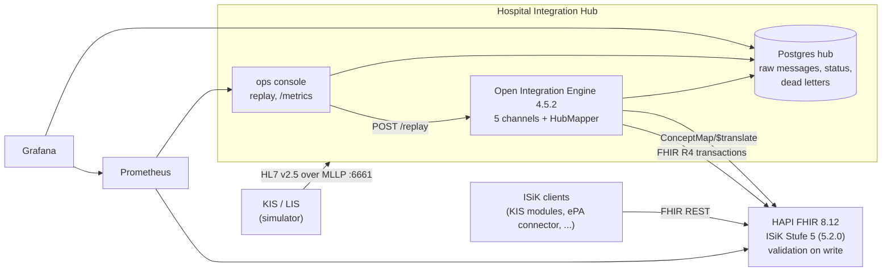
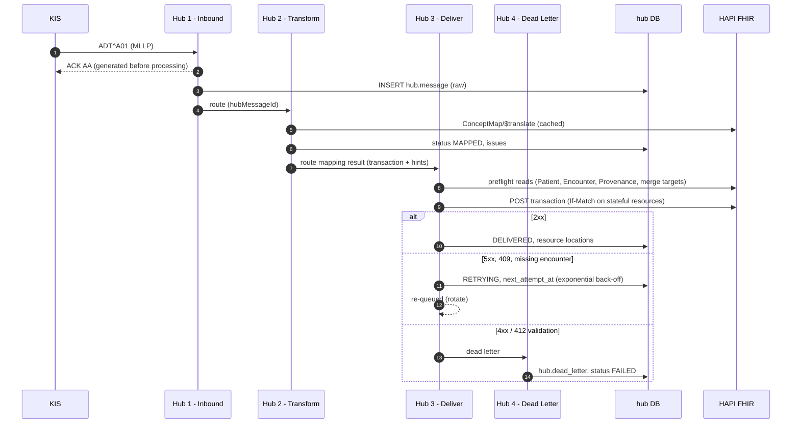

# Architecture

## Context

## Channel pipeline

Each channel has its **own source queue**, so the KIS gets its ACK after the engine has persisted the message, and a slow or unavailable FHIR server never backs up the MLLP connection. This is store-and-forward: the ACK means "received and stored", not "in the FHIR server". That is the usual contract for hospital interfaces, and it is why dead letters and replay exist.

| Channel | Source | Destination | Queue |
| --- | --- | --- | --- |
| Hub 1 - Inbound | TCP Listener, MLLP, port 6661, HL7 v2 | JavaScript Writer: store raw + route | source queue |
| Hub 2 - Transform | Channel Reader | JavaScript Writer: `HubMapper.transform` | source queue; destination queue for retryable terminology errors |
| Hub 3 - Deliver | Channel Reader | JavaScript Writer: `HubMapper.deliver` | source queue; destination queue *on failure*, rotate, 4 threads partitioned by patient |
| Hub 4 - Dead Letter | Channel Reader | JavaScript Writer: record failure | source queue |
| Hub 5 - Replay | HTTP Listener, port 8091 `/replay/` (internal network; OIE redirects `/replay` to `/replay/`, and HTTP clients drop a POST body on that redirect) | JavaScript Writer: re-route stored messages | — |

## Code organisation

| Part | Where | Runs in | Tested by |
| --- | --- | --- | --- |
| Parser, mappers, terminology port, delivery logic | `mapper/src` (TypeScript) | compiled to one ES5 file, `mapper/dist/hub-mapper.js`, loaded as OIE code template `HubMapper` | Node unit tests, golden files, Rhino smoke test |
| Engine adapters (JDBC, HTTP, config map, routing) | `engine/code-templates/hub-runtime.js` | OIE code template | e2e |
| Channel glue (about 30 lines each) | `engine/scripts/*.js` | JavaScript Writers | e2e |
| Channel definitions | `engine/src/channels.ts` → `engine/channels/*.xml` | imported by `engine/tools/deploy.ts` via the OIE REST API | XML checks, CI "build output up to date" |

The mapper is pure: it takes the raw message and a terminology port and returns a transaction Bundle and *delivery hints*. The engine never contains mapping logic, so the hard part is covered by fast tests that need no running engine. ADR 0001 has the details.

## Delivery: read, reconcile, write

FHIR conditional updates (`PUT Patient?identifier=…`) make each write idempotent. They are not enough for state that evolves over several messages, so the Deliver step reads the stored version first for two resource types:

- **Patient**: merge aliases (`use=old` identifiers) and links survive messages that do not know about them. If the message's event time is older than the last applied event (from `Provenance?target=…&_sort=-when`), the stored demographics win.
- **Encounter**: status only moves forward, locations no longer reported become `completed` history, and diagnoses/account/discharge details survive messages that omit them.

The reconciled resource is sent as `PUT Patient/{id}` with `If-Match: W/"{version}"`. When another writer got there first, HAPI answers 409 and the message is retried with a fresh read. All writes of one message are one transaction: either everything commits or nothing does.

## Ordering and scaling

Inbound and Transform run one thread each, so messages reach the Deliver queue in the order the KIS sent them. The Deliver destination runs **4 queue threads** with OIE's **thread assignment variable** `hubPartition`, which the Transform step sets to the Patientennummer. All messages of one patient therefore go through the same thread in order, different patients are delivered in parallel, and concurrent conditional creates for the same patient cannot happen. Out-of-order arrivals from the KIS itself are tolerated through the reconcile rules above. A rotating queue lets later messages pass one that waits for its encounter.

Measured limits on the test machine (4 vCPU for the whole stack): ingestion about 43 msg/s with ACK p95 210 ms, Inbound/Transform about 12 msg/s, delivery 5 msg/s without and 1 msg/s with ISiK validation ([results](results.md)). The FHIR server's validation is the bottleneck, so the next steps are more CPU for HAPI and more Deliver threads.

## Rhino performance notes

The mapper runs in Rhino's interpreter-like mode, so arithmetic-heavy code is expensive. Profiling in the engine's Rhino 1.7.13 ([`engine/test/rhino-bench.js`](../engine/test/rhino-bench.js)) showed that mapping an ADT^A01 took 107 ms, almost all of it in the deterministic hash. Two changes brought it to 23 ms with identical results for ids:

- the FNV prime multiplication is done as `(h << 24) + h * 403`, which is exact in doubles, instead of a generic 32-bit multiply, and the four hash lanes share one pass;
- bundle fullUrls (only unique within one bundle) use one hash of the message key plus a counter. Ids that must be stable across replays (Provenance, Binary) still use a full hash.

Hub DB access uses a HikariCP pool (shipped with OIE) instead of a new JDBC connection per statement.

## Failure handling

| Failure | Where | Result |
| --- | --- | --- |
| Unparseable message, missing required field, unknown code system | Transform | dead letter `PARSE_ERROR` / `MISSING_REQUIRED_FIELD` / `INVALID_VALUE` |
| Local code or unit without a ConceptMap entry | Transform | dead letter `TERMINOLOGY_UNMAPPED`; add the mapping to `terminology/`, re-seed, replay |
| Terminology server down | Transform | `QUEUED`, retried by the engine |
| FHIR server down / 5xx / 429 / 409 | Deliver | `RETRYING` with back-off 1, 2, 4, … 60 s; dead letter `RETRY_EXHAUSTED` after 10 min |
| Encounter referenced by ORU/ORM/MDM does not exist yet | Deliver | `DEPENDENCY_MISSING`, retried like above |
| Profile validation error (HAPI 412/422), ambiguous conditional match | Deliver | dead letter `VALIDATION_FAILED` / `AMBIGUOUS_MATCH` with the server's OperationOutcome |
| Unexpected script error | any | dead letter `ENGINE_ERROR`; OIE also marks the message ERROR |

Replays create a new `hub.message` row with `replay_of` set, so every attempt stays auditable.

## Security notes

- Synthetic data only, generated by `simulator/` (no real person data anywhere in the repo).
- All host ports bind to 127.0.0.1. The replay endpoint is reachable only on the Docker network.
- Default credentials (`admin/admin`, database passwords) are for local development and are overridden via `.env`. OIE's self-signed certificate is accepted only by the deploy and ops clients.
- Before production you would need: TLS on MLLP (or a VPN), SMART Backend Services or mTLS towards the FHIR server, secrets from a vault, OIE user management, and hub DB pruning aligned with the hospital's retention rules (DSGVO, § 630f BGB).
